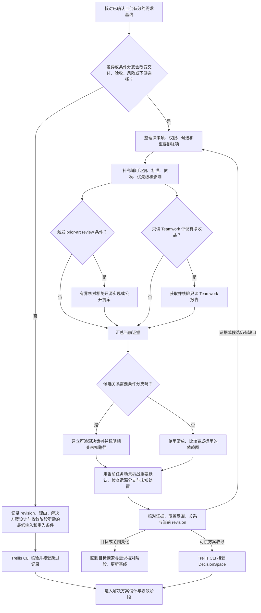

# 决策空间构造与归并阶段流程

核对目标探索与需求核对阶段已确认的目标基线及当前 `artifact_revision`。判断候选差异、条件分支是否会影响交付、验收、风险或下游选择。若没有实质差异，可记录基线引用、跳过理由、解决方案设计与收敛阶段的最低输入和需要重新进入本阶段的变化条件，再由 Trellis CLI 核验跳过。

需要构造时，梳理决策项及其权限、候选、重要排除项与理由；按需补齐证据、适用约束、标准、阈值、依赖、影响和优先级。证据足够时给出推荐；证据不足则保留未知或待决项，不伪造结论。仅当选择之间存在条件依赖时使用决策树，并标明分支条件、来源、未知路径及其下游影响。互斥、共享依赖或汇合关系可用依赖图；独立候选用比较表或清单即可。

候选尚未覆盖实质选择时，从不同机制、责任边界或运作方式拓宽，而非只列同一做法的参数变体；适用时纳入维持现状或不做。再以已确认约束、当前实现、外部先例及必要的有界探针筛选，区分不可行、代价较高与证据不足，保留排除理由及依赖后果。移交前还应完成下述重要默认与遗漏分支核对；不凑候选数量，不在没有新证据时追加轮次。目标变化回第一阶段，用户保留决定整理给第三阶段，不由辅助 Skill 提前锁定。

新颖机制、重大重构、跨组件边界变化或关键取舍缺少可信本地先例时，进行有界的 `prior-art review`，记录适用性与采纳或排除理由。只读 Teamwork 可按需补充证据；主代理核验报告后归并。将 `DecisionSpace` 或有据跳过记录交由 Trellis CLI 接受，待用户决定交由解决方案设计与收敛阶段处理。

移交前，从当前目标的实际使用、失败或交付场景挑战重要默认假设，检查候选之外是否仍有会改变行为、责任或验收的分支。可查事实由代理补证，真实用户取舍交第三阶段处理；尚未满足前置或暂不能精确表述的未知，说明影响哪个决定及后续处理，不能因当前无就绪问题就当作已解决。在现有产物简短保留关键发现、排除依据和未决项的移交方式；重要选择可比较且未知已有处置路径时停止，不穷举理论分支，也不把每个默认都变成用户问题。

### 离开阶段的条件

- 有实质决策空间时，候选、关键证据、关系、未知项和推荐均能支持下一阶段比较；不要求固定字段数量或同时使用多种图表。
- 无实质差异时，跳过记录须能说明当前基线、判断依据和重新进入条件。
- 保留用户决定不在本阶段锁定；外部参考不替代项目事实或用户选择。
- 已检查影响当前目标的重要默认和遗漏分支，关键未知有受影响决定及移交路径；没有就绪问题不单独构成退出依据。
