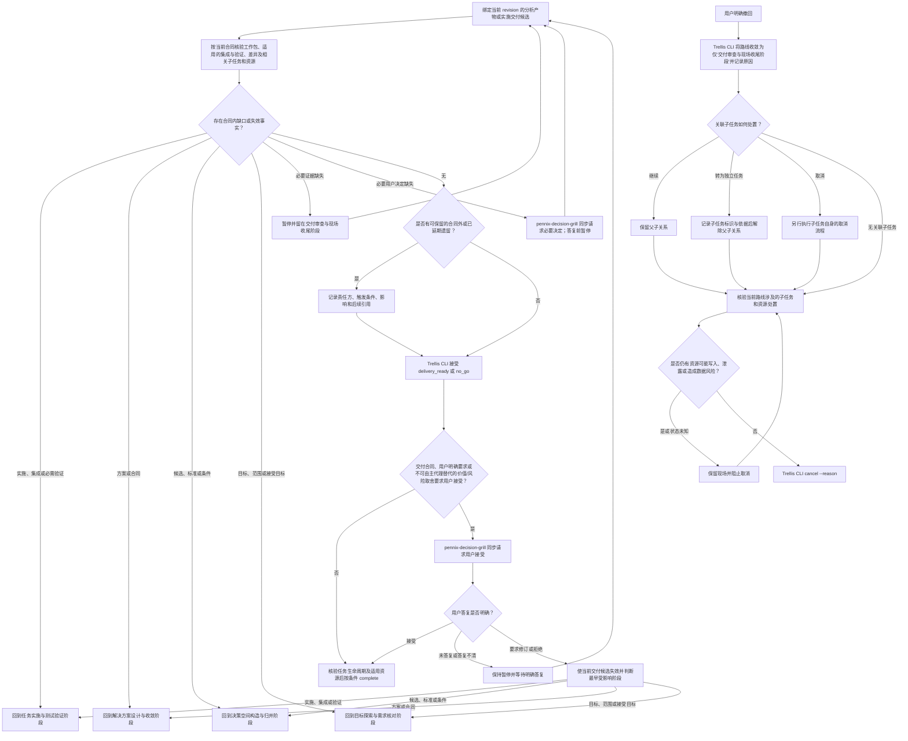

# 交付审查与现场收尾阶段流程

绑定当前 `task_route_revision`、输入和结果 revision，按解决方案设计与收敛阶段确认的优先级和依赖检查任务实施与测试验证阶段的工作包、适用的集成与验证、合同差异和未结发现；只有路线实际涉及必需子任务或受托资源时，才核对相应事实。分析型路线只核对实际分析产物，不制造实施工作包。验证按通过、失败、未运行或受限记录；合同允许且风险可接受时说明未运行原因、影响和替代证据，否则暂停或回到任务实施与测试验证阶段。

实施、集成或必需验证缺陷回到任务实施与测试验证阶段；方案、合同、风险、依赖、回退或停止条件失效回到解决方案设计与收敛阶段；候选、标准或条件变化回到决策空间构造与归并阶段；目标、范围或接受目标变化回到目标探索与需求核对阶段。必要证据缺失时，暂停并停留在交付审查与现场收尾阶段；必要用户决定缺失时，通过 `pennix-decision-grill` 同步请求决定，答复前保持暂停，收到答复后重新核对当前输入和受影响阶段。当前合同内未完成工作不能改记为遗留后关闭。合同外、已明确延期或撤回后不继续的事项，可在现有收尾产物中记录范围、责任方、触发条件、影响和后续任务引用；没有遗留时不另造清单。

满足当前合同且没有待处理缺口时，由 Trellis CLI 接受交付审查并形成 `delivery_ready`；`no_go` 也须经交付审查与现场收尾阶段后才能完成任务。只有合同、用户明确要求或不可由主代理替代的重要价值与风险取舍需要用户接受时，才等待用户确认。用户要求修改或拒绝时，使当前交付候选失效并按影响回流。调用 `complete` 前核验任务生命周期；只有路线实际创建、委派或依赖外部执行资源时，才核验其处置状态。相关资源仍可能写入、泄露、造成数据风险或状态无法确认时，保留现场并阻止完成。若用户明确撤回，Trellis CLI 将路线收敛为仅包含交付审查与现场收尾阶段并记录原因；存在关联子任务时，逐项记录继续、转为独立任务或取消的决定及依据，继续时保留父子关系，转为独立任务时记录子任务和依据后再解除关系，取消时另行执行子任务自身的取消流程。完成子任务处置后，再核验当前路线实际涉及的外部执行资源；资源仍可能写入、泄露、造成数据风险或状态无法确认时保留现场并阻止取消，风险解除后才调用 `cancel --reason`。

### 与会话交接的边界

正式会话交接包仅在用户明确要求时按其独立 Skill 处理。它不改变阶段、路线或任务状态，也不是 `delivery_ready`、`complete` 或 `cancel` 的前置条件。

完成或取消不会删除任务证据。退役的空业务 session、旧提示缓存和旧锁先用 `task.py runtime [<task>]` 预览，核验当前用途、writer 协议和指纹后按精确摘要确认；固定锁、有效控制记录、未知字段和恢复材料保留。Teamwork 证据按其原生命令审查引用与用途；交接包及其生命周期材料按 handoff owner 的独立合同处理。历史引用缺失、空锁或零运行成员都不能单独证明资产可删。
