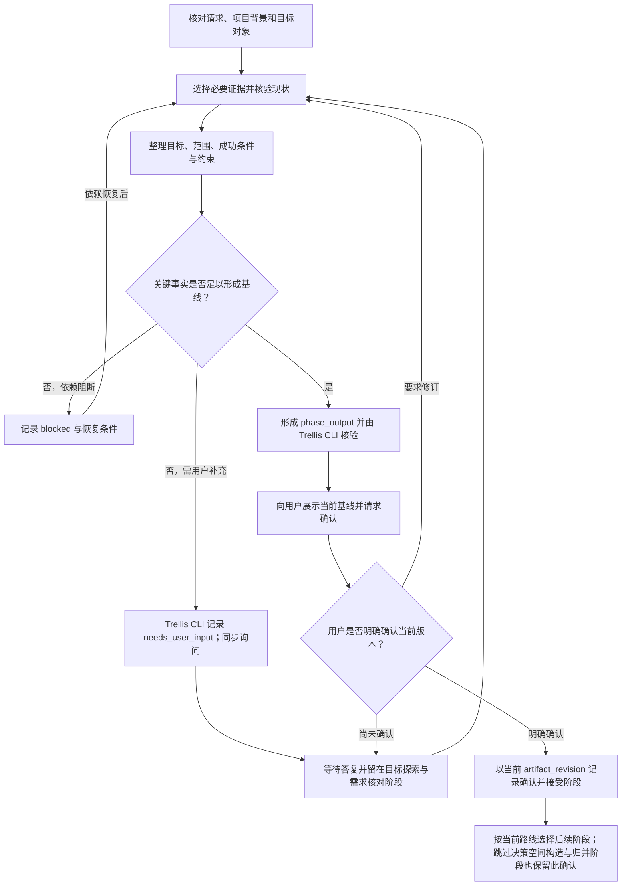

# 目标探索与需求核对阶段流程

先核对用户请求、目标对象和项目背景。新项目明确问题、用户、领域及系统边界；既有项目核对目标仓库、组件、当前版本、适用规则、现状和影响范围。按问题选择本地源码、历史记录、外部资料或用户维护知识等证据来源；只在独立取证有净收益时使用 Trellis Teamwork。

整理目标、范围、成功条件、关键约束和责任方。区分已知事实、假设、证据冲突和未知事项；缺少会改变目标或路线的用户事实时，通过 `pennix-decision-grill` 同步询问。记录会阻断推进的问题及恢复条件；不影响当前路线的事项可明确责任方和后续处理。

当请求只描述症状、先给出解法或目标含糊时，先对照实际使用情境、当前行为与期望结果，必要时回述问题，检验是否过早限定了解法。区分硬约束与可挑战的惯例、未经证实的假设；只追查会改变本轮目标、范围或成功条件的信息。明确本轮要改变什么、怎样观察成功、哪些不做及哪些未知仍有实际影响后即可收敛，不强制访谈轮数或将开放问题缩成 MVP。已知目标直接复用，没有价值或不宜继续也可形成适用的分析路线。

形成 `phase_output`，至少包含当前目标与需求基线、必要证据、不确定性、`phase_result` 和非约束性的 `route_advice`。`route_advice` 简要说明任务类型、复杂度画像和项目背景如何影响阶段选择，并记录复杂度判断的实际触发维度与理由；不机械计分或套用固定路由矩阵，也不要求固定字段或篇幅。路线发生变化时，使用 Trellis CLI 更新受影响的分类和阶段，并按影响范围重新核验。阶段可等待用户补充或因依赖阻塞；只有用户确认当前基线且阶段产物有效时，才以 `accepted` 离开本阶段。将阶段产物及引用提交 Trellis CLI 核验后，向用户展示简明基线并请求确认或修订。

### 离开阶段的条件

- `accepted` 及明确用户确认必须绑定当前 `artifact_revision`；产物改变后重新核验并取得确认。
- `needs_user_input` 或 `blocked` 时不推进阶段游标。
- `terminated` 不代表用户撤回任务；如用户明确撤回，按交付审查与现场收尾阶段中的取消审查处理。
- 可从目标探索与需求核对阶段直接进入解决方案设计与收敛阶段，但不能绕过需求基线确认。
