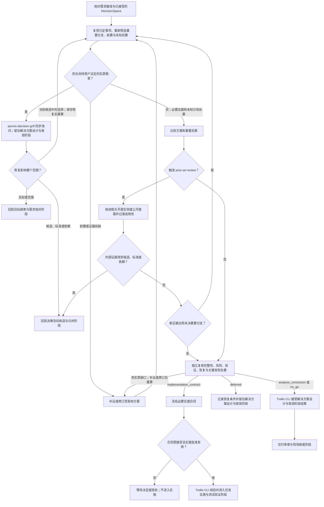

# 解决方案设计与收敛阶段流程

核对有效的目标基线、决策空间构造与归并阶段结果或跳过记录及其 revision。按依赖筛选影响目标、范围、成功条件、用户偏好、风险承受或重要取舍的保留决定；使用 `pennix-decision-grill` 同步提问。答复到达后，核对其权限、当前 revision 和影响范围：影响目标或范围时回到目标探索与需求核对阶段，影响候选、标准或依赖时回到决策空间构造与归并阶段，仅改变当前候选中的方案时继续本阶段评估。待决定事项使解决方案设计与收敛阶段保持待决。

比较适用方案，说明选择依据、重要后果、行为边界、责任、必要依赖、验证方式、停止与恢复条件及实质风险。对新颖核心机制、重大重构、跨组件边界变化或关键不确定性缺少可信本地先例的方案，在结果接受前完成有界 `prior-art review`，记录适用性、采纳或排除理由，或说明没有适用先例。外部材料改变候选、标准或依赖时回到决策空间构造与归并阶段。

用户答复、新证据、方案修订或复核发现后，重新筛选受影响的重要选择：是否出现新分支、前置是否满足、原决定是否仍有效。先保存真实答案及其影响，只重开受影响项；可查事实继续补证，用户取舍按依赖提问，不把问完原有列表或当前无就绪问题等同于方案完整。关键未知须有补证、用户决定、明确接受的剩余风险、延期或不继续等处置，不能静默排除。

判断当前结果：分析交付形成 `analysis_conclusion`；不继续形成 `no_go`；延期形成带责任方、触发条件和恢复位置的 `deferred`，留在解决方案设计与收敛阶段；实施路线形成 `implementation_contract`，明确目标、范围和接受条件，并按路线需要补足实施与核验信息。只有交付物具有独立实施或集成边界时才拆分工作包，并说明推进和协作所需的依赖、顺序、责任或集成信息；单一交付不人为拆分工作包。解决方案设计与收敛阶段的结果接受与实施授权分开记录；只有合同及明确批准均有效时，Trellis CLI 才允许进入任务实施与测试验证阶段。

合同结果已接受、实施尚未授权时，发现需要返修，应通过 `task.py phase return` 回到本阶段或更早受影响阶段，记录理由和证据。受影响的接受与授权随之失效；修订后重新接受当前产物，再核验实施授权。

接受 `implementation_contract` 前，在合同中建立 `## 验收覆盖` 表，表头为 `接受条件 | 工作包 | Owner | 验证入口 | 交付证据 | 停止条件`。逐条映射已接受条件，核对实际源码 owner、可运行验证、证据落点和停止条件；单一工作包可以覆盖多条条件。CLI 仅检查表结构及非空内容，不能代替语义审查。目标、合同、决策与执行记录分别使用明确的文件引用，执行细节追加到 execution 或 research，避免修改已接受的上游合同。

逐项决定回答后，将已决目标、候选依据、接口与数据流、owner、依赖顺序、实施和验证，以及适用的迁移、发布、资源和失败恢复安排组织为一个完整方案。核对需求覆盖、跨产物一致性、可实施性和可验收性；有净收益时使用有界反例或压力测试，先修复可查缺口。向用户展示可识别的整体方案和实质剩余取舍后，再记录当前 revision 的接受及实施授权。逐项答复不自动等于整体批准；用户已充分明确批准整体方案时不重复索取。目标或候选问题回最早受影响阶段，局部方案问题在本阶段解决，不增设外部封口状态。

研究、原型和协作证据写回现有阶段产物、research 或 execution 自然落点，注明来源与版本、事实和假设、适用性、限制及决定影响。证据足够即停止扩搜；工具、报告或模板不能替代用户决定和 Trellis 原生接受事实。

请求整体批准前，落实已有独立复核，在现有产物简短说明关键反例、发现及处置。以当前任务的具体行为或交付物检验端到端可执行性与验收依据；涉及发布安装时，核对本地验证、发布产物和实际运行身份的关系，不能只凭版本字符串认定同一产物。发现未决重要选择就回到筛选，不为没有新发现的情况追加轮次；充分的整体接受和实施授权不重复索取。

### 方案是否足以收敛

实施者应能从当前方案判断要做什么、由谁负责、依赖什么、如何验证，以及何时停止或恢复；影响选择、接受、安全、权限、成本或不可逆影响的取舍应有依据和处理方式。未知事项可以补证、接受剩余风险、延期或不继续。此判断不要求固定篇幅、备选数量、字段或图表。
