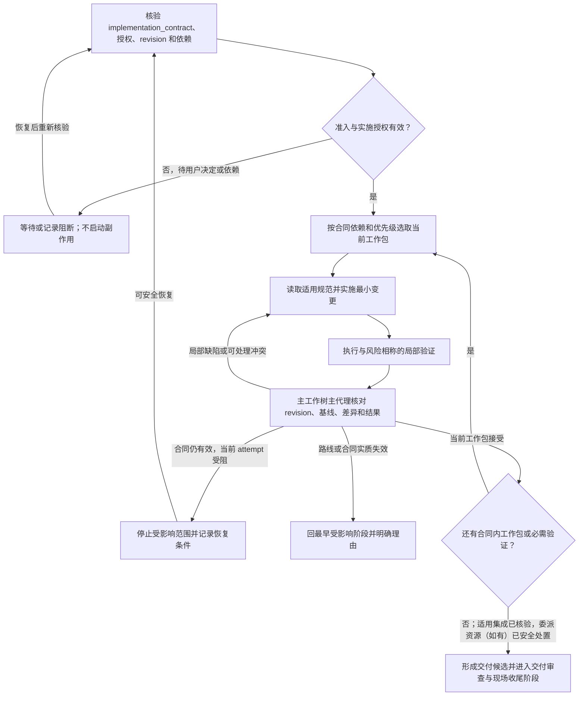

# 任务实施与测试验证阶段流程

开始前核验当前 `implementation_contract`、实施授权、路线 revision、必要依赖和执行基线。使用 `trellis-before-dev` 读取目标仓库实际适用的规范；按组件 owner 合同选择主工作树或已批准的独立写入路线。调用项目任务 `start` 只在实施授权有效时将任务置为 `in_progress`。

实施阶段为 `blocked` 或 `waiting_user` 时，先解决阻塞并经原生 `phase resume` 恢复，再重新核验准入。`delegate-start` 核验父任务已有的 ownership 围栏和子任务状态；存在未消费交接、当前会话不符合已有 ownership 记录，或子任务已完成、取消时，不启动或复用委派执行。没有 ownership 记录的任务不具备默认会话独占保护。

父授权有效且本轮允许委派写入时，先加载 `trellis-worktree-delegation`，通过其原生新协议入口冻结明确目标、设置与能力要求，再准备、核验 ready、执行和观察。委派节点沿 `TRELLIS_DELEGATION_CONTEXT` 与共享节点方法执行本包，不进入主控阶段或新建任务。输入漂移先保全并核对授权；未知创建或发送只做原生 inspect 和显式 recover，不覆盖映射或重放。结果由 owner 审查并在目标分支 merge/FF，验证 ancestry 后再显式核销；idle/cancel 不替代 writer 停止证据。

按合同的依赖和优先级选取当前工作包，实施满足目标的最小变更，并运行与风险和影响相称的局部验证。主工作树主代理核对来源、revision、Git 基线、差异和结果后接受工作包。多包任务按合同集成；单一交付不人为拆分。Trellis Teamwork 仅用于冻结计划下的只读比较或评议，不能改写任务状态或接受实施结果。实际写入委派依父任务规定使用 Trellis 受控入口与 Paseo；各组件源码仍在 owner 仓库内修改。

局部失败、暂时不可用或当前状态已满足接受条件时，先在任务实施与测试验证阶段中处理。依赖或资源暂不可用且现场安全时记录恢复条件；未授权不产生外部副作用；未知现场先停止并核验。合同允许未运行验证且风险可接受时，记录原因、影响和替代证据。替代路线若改变授权、成本、隐私或接受条件，回到解决方案设计与收敛阶段；目标、范围变化按影响回到目标探索与需求核对阶段或决策空间构造与归并阶段。只有合同范围内工作包均已接受、适用必需验证完成或有有效未运行处置、按范围和风险需要的集成验证通过，才将交付候选交由交付审查与现场收尾阶段；仅当路线实际创建或委派资源时，才核验其处置事实。

### 委派、回退与收敛

合同不变的局部修复在当前活动阶段处理；需要撤销实施或交付接受事实时，使用 `phase return --return-kind execution_rework` 并提供原因、证据及目标阶段。仅在需求、合同摘要、路线和依赖仍有效时保留实施授权；CLI 拒绝时核对真实失效原因，不重复索取已有效的用户决定。合同实质变化使用默认 `contract_change` 回到最早受影响阶段并重新接受、授权。终态任务先经独立的 `reopen` 恢复到 `planning`，再操作工作流阶段；重开不复用旧授权。

回退使用当前 owner 的 Git 和资源合同，不覆盖无关改动，也不删除仍需核验的现场。只有当前合同无法安全覆盖目标、授权、依赖、基线、接受条件或停止条件的变化时，才回退到最早受影响阶段。结束任务实施与测试验证阶段前，记录适用验证结果、未运行处置、合同差异和未结发现；仅当路线实际创建或委派资源时，记录其处置状态。
