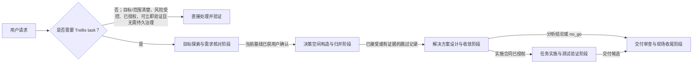

# Trellis 工作流

## 核心原则

1. 保持下表列出的业务阶段各自独立。每个阶段都有自己的活动、产物、接受条件和回流路径。
2. 任务与阶段事实由 Trellis CLI 管理。Skills、Hooks、Teamwork、Paseo 和其他组件按各自职责提供指引、证据或执行能力。
3. 采用满足任务风险和验收需要的最小流程。可以基于证据跳过阶段；目标清楚、责任方单一、范围封闭、风险受控、已获授权、能在当前会话立即验证且不需要持久路线、协调、设计、审查、发布、安装、迁移或外部交付的请求可以不创建 Trellis task。不可逆动作还必须有精确对象核验、可接受的恢复或损失边界和停止条件；用户授权不是唯一充分条件。
4. 在任务资产中记录决定和当前证据。不得从阶段状态、Teamwork 结果或会话交接状态推断任务状态。

## 协作机制与执行者命名

| 机制英文名 | 机制中文名 | 执行者英文名 | 执行者中文名 |
| --- | --- | --- | --- |
| Trellis Teamwork | Trellis 团队协作 | Trellis teammate；复数 Trellis teammates | Trellis 团队成员 |
| Paseo-based-parallelism | Paseo 并行协作 | Paseo delegated-agent；复数 Paseo delegated-agents | Paseo 委派 Agent |

首次出现或跨机制比较时使用全称，语境唯一时可简称“团队协作／团队成员”“并行协作／委派 Agent”。机制、执行者、session、工作树、节点、attempt 和工作包分别指其实际对象；provider 表示执行宿主，不替代机制名称。Paseo 并行协作允许只有一个执行者。命令、Skill 名称、路径、配置键和协议字段保留原生字面，例如 `trellis teamwork` 与 `trellis-worktree-delegation`。

Trellis 团队成员接收主 Agent 已明确的只读工作包；Paseo 委派 Agent 接收已授权第四阶段的实施工作包，不重跑前三阶段，也不主持第五阶段的最终接受。两类执行者不直接询问用户，不以用户提问工具作为必需能力；缺项、限制、范围外选择或阻塞通过各自原生报告返回主 Agent，由主 Agent 先补证、调整分工，确有用户取舍时再提问。

## Trellis 项目上下文

### 按需采用辅助方法

根据当前业务问题主动选择宿主已声明的 Skill，无需用户点名。方法明确时直接使用；组合、职责不清或阶段衔接时，可按需读取可用的工作流总路由（例如 `pennix-workflow-routing`）。具体方法与场景由该 Skill 拥有，不在本工作流复制集合清单，也不要求安装某个可选集合。

只加载相关方法，完成实际证据或产物后返回当前阶段或任务外请求。方法不拥有阶段状态、结果接受或动作权限；已有授权步骤继续推进，实质改变目标或合同才走原生回流。阶段切换和恢复时只重评受影响的方法，不重复初始化、全集读取或已定问诊。Skill 缺席不阻断原生阶段工作。

### 项目规范

`.trellis/spec/` 保存项目和 package 规范。修改代码前，读取适用的 `AGENTS.md` 和规范文件。使用 `get_context.py --mode packages` 查找 package 与规范层级。

```bash
python3 ./.trellis/scripts/get_context.py --mode packages
python3 ./.trellis/scripts/get_context.py --mode spec --file <path>
```

### 任务记录

Trellis task 按 `task.json.status` 存放在 `.trellis/tasks/planning/<task>`、`in_progress/<task>`、`completed/YYYY-MM/<task>` 或 `cancelled/<task>`。创建进入 `planning`，获准实施后启动进入 `in_progress`；目录仅是状态的投影。每个任务包含 `task.json`、需求以及任务所需的设计、实施、研究或上下文资产。使用 Trellis CLI 创建和启动任务、初始化和推进阶段路线，以及完成或取消任务。不得手工修改任务状态或阶段状态。

```bash
python3 ./.trellis/scripts/task.py create "<title>" [--slug <name>] [--parent <task>]
python3 ./.trellis/scripts/task.py phase init <task> --task-kind <analysis|implementation|combined> --complexity <simple|standard|complex> --project-context <new|existing> --phase-ids <ordered-ids>
python3 ./.trellis/scripts/task.py phase show <task>
python3 ./.trellis/scripts/task.py validate <task>
python3 ./.trellis/scripts/task.py start <task>
python3 ./.trellis/scripts/task.py complete <task>
python3 ./.trellis/scripts/task.py cancel <task> --reason "<reason>" --evidence-ref <reference>
python3 ./.trellis/scripts/task.py reopen <task> --reason "<reason>" --evidence-ref <reference>
```

使用 `phase artifact`、`accept`、`skip`、`wait`、`block`、`resume`、`return`、`route` 和 `authorize` 执行对应的阶段操作。准确参数以 `task.py --help` 为准。跳过阶段必须提供理由和证据；目标探索与需求核对阶段不可省略。

只有阶段路线已到达获准的实施入口时，`task.py start` 才会将任务从 `planning` 改为 `in_progress`。分析任务可在交付审查与现场收尾阶段后仍处于 `planning` 时完成。`complete` 将任务移入 `completed/YYYY-MM/<task>`，`cancel` 将任务移入 `cancelled/<task>`，并在同一事务中清除任务的运行时会话指针。

工作流阶段回流与原生任务生命周期恢复分别操作。`completed` 或 `cancelled` 任务需要在原线程继续时，先用 `reopen` 恢复到 `planning`，保留终态事实、取消原因和恢复证据，清除旧运行态、实施授权和依赖准入；工作流阶段保持原记录。随后用 `phase return` 回到最早受影响阶段。实现任务重新接受合同、取得新的实施授权并核验准入后，才由 `start` 进入 `in_progress`。`phase return` 不能直接修改终态任务。

`phase return` 默认采用 `contract_change`，使受影响阶段接受和实施授权失效。合同不变的局部实施或证据返工可显式使用 `--return-kind execution_rework`，目标限于实施或交付阶段，可重入当前阶段；CLI 核验需求、已接受合同、授权摘要、路线 revision 和已声明依赖准入仍有效后，保留授权，清理目标阶段及下游的接受事实。不能以此修改目标、合同或绕过待决依赖。普通局部修复可直接在当前活动阶段完成，无需为了记录进展而回流。

新接受的 `implementation_contract`（以及省略设计阶段时新授权的合同）必须包含 `## 验收覆盖` 表，表头固定为 `接受条件 | 工作包 | Owner | 验证入口 | 交付证据 | 停止条件`，至少一行且各单元格非空。CLI 负责结构检查，阶段 Skill 负责逐条核对已接受条件的语义覆盖。既有接受和授权不会因本次升级自动失效；再次接受或授权时执行新检查。

旧布局须先预览 `task.py migrate-layout`，核对后执行 `task.py migrate-layout --apply`；旧 `archive/YYYY-MM` 中已完成的任务保留原月份，其他任务按真实状态放置。迁移会同步 JSON/JSONL 机器引用、会话指针和运行态索引，保留任务身份与父子关系，不重授历史授权。未完成事务会阻止普通任务命令，须用 `task.py migrate-layout --recover` 恢复；输入被外部改动时停止并保留现场。路径或产物内容改变导致接受证据失效时，须经原生阶段接受或 continuity 核对重新收敛。

在支持原生实施或检查 agent 的平台上，任务上下文清单（`implement.jsonl`、`check.jsonl`）用于提供相关规范和研究资料。只有这些 agent 会读取清单时才需要维护；清单不能替代任务资产或阶段证据。

### 工作区与会话上下文

会话日志保存在 `.trellis/workspace/<developer>/`，用于记录会话进度，与 Trellis task 生命周期及正式会话交接包相互独立。

```bash
python3 ./.trellis/scripts/get_context.py
python3 ./.trellis/scripts/get_context.py --mode phase
python3 ./.trellis/scripts/add_session.py --title "<title>" --summary "<summary>"
```

每个 task 的 workflow selector（`task.json.workflow`、开发者偏好或 `config.yaml` 默认值）用于选择工作流文档。它独立于任务的 `phase_ids` 和 `current_phase_id`，不会创建另一条阶段路线。

## 阶段索引

任务路线从下表列出的业务阶段中按需选取，组成有序路线；每个阶段对应一个提供本阶段流程和图示的 Skill。

| 业务阶段 | 内部标识 | 对应 Skill | 目的 |
| --- | --- | --- | --- |
| 目标探索与需求核对阶段 | `goal_exploration_and_requirements` | `trellis-goal-exploration-and-requirements` | 建立并由用户明确确认当前目标与需求基线。 |
| 决策空间构造与归并阶段 | `decision_space_construction_and_merging` | `trellis-decision-space-construction-and-merging` | 识别、比较并整理实质选择及其依赖。 |
| 解决方案设计与收敛阶段 | `solution_design_and_convergence` | `trellis-solution-design-and-convergence` | 收敛决策，并接受分析结论或实施合同。 |
| 任务实施与测试验证阶段 | `task_implementation` | `trellis-task-implementation` | 实施并验证已获授权的合同。 |
| 交付审查与现场收尾阶段 | `delivery_review_and_closeout` | `trellis-delivery-review-and-closeout` | 审查当前交付、处理缺口并完成或取消任务。 |



图示表达常见阶段转换，不是固定路线矩阵。目标探索与需求核对阶段保留当前目标和需求基线的用户确认；后续业务阶段可按任务需要和现有证据省略。进入决策空间构造与归并阶段或解决方案设计与收敛阶段的路线均须保留该确认。`no_go` 仍须经过交付审查与现场收尾阶段。正式会话交接是独立附加操作，只有用户明确要求时才执行，也不是任务推进或收尾的前置条件。

<!-- 宿主 Hook 从以下区块读取每轮工作流提示。 -->

[workflow-state:no_task]
先按 taskless 合同判断目标、责任方、范围、风险、授权、立即验证和持久治理需要。全部满足时直接处理并验证，不创建 task；不可逆动作还要核验精确对象、恢复或损失边界和停止条件。若模型判断需要任务而用户没有明确要求创建，先说明不满足的门槛、任务 owner/范围/路线和不建任务的风险，向用户申请后再调用 create。用户明确要求创建或恢复任务时复用该创建授权。创建任务不代表获准实施。
[/workflow-state:no_task]

[workflow-state:task_error]
活动任务记录无法读取。停止修改任务状态，依据现有任务资产修复该记录后再继续。
[/workflow-state:task_error]

[workflow-state:planning]
任务尚未初始化阶段路线。核对需求后，按适用性选择有序阶段，并为省略阶段记录理由和证据，再使用 `task.py phase init`。解决方案设计与收敛阶段的实施合同获接受且另行取得实施授权前，不得开始实施。
[/workflow-state:planning]


[workflow-state:in_progress]
任务生命周期状态为 `in_progress`。读取下方当前阶段提示。任务实施与测试验证阶段按已接受合同和目标包适用规范推进，并运行与改动相称的验证。代码修改前或切换目标包时，可使用 `trellis-before-dev` 辅助定位规范；需要完整质量核验时，可使用 `trellis-check`。协作仅通过已授权的 trellis teamwork 或 paseo-based-parallelism；已有历史记录不授予派发权限。实施变更不得超出授权范围。
[/workflow-state:in_progress]


[workflow-state:goal_exploration_and_requirements]
读取 `trellis-goal-exploration-and-requirements` 及其 `workflow.md`。用户明确确认当前需求资产 revision 前，不得离开目标探索与需求核对阶段。
[/workflow-state:goal_exploration_and_requirements]

[workflow-state:decision_space_construction_and_merging]
读取 `trellis-decision-space-construction-and-merging` 及其 `workflow.md`。只有条件依赖会改变下游选择时才使用决策树；本阶段无实质价值时，记录有证据支持的跳过理由。
[/workflow-state:decision_space_construction_and_merging]

[workflow-state:solution_design_and_convergence]
读取 `trellis-solution-design-and-convergence` 及其 `workflow.md`。接受阶段前解决保留给用户决定的事项；已接受的实施合同不等同于实施授权。
[/workflow-state:solution_design_and_convergence]

[workflow-state:task_implementation]
读取 `trellis-task-implementation` 及其 `workflow.md`。遵循已授权的实施合同，并使用源码 owner 仓库的规范、工具和验证路径。
[/workflow-state:task_implementation]

[workflow-state:delivery_review_and_closeout]
读取 `trellis-delivery-review-and-closeout` 及其 `workflow.md`。核对当前合同和 revision，解决缺口或按影响回流，并在完成或取消任务前确认资源安全。
[/workflow-state:delivery_review_and_closeout]

### 目标探索与需求核对阶段

#### 1.1 建立需求基线

读取目标探索与需求核对阶段 Skill。仅收集可能改变目标、范围、接受标准、约束或路线的证据。将当前基线记录为阶段产物，并在推进前取得绑定其当前资产 revision 的用户明确确认。

### 决策空间构造与归并阶段

#### 2.1 整理实质决策

读取决策空间构造与归并阶段 Skill。选择能表达相关选项及其关系的最简方式。满足既定触发条件时查找外部先例；Teamwork 仍是可选的只读证据支持。

### 解决方案设计与收敛阶段

#### 3.1 收敛当前方案

读取解决方案设计与收敛阶段 Skill。解决必要的用户决定，并依据当前目标、风险、责任、依赖、验证、停止与恢复条件及重要后果审查方案。通过 Trellis CLI 接受当前阶段结果。

### 任务实施与测试验证阶段

#### 4.1 实施已授权合同

读取任务实施与测试验证阶段 Skill、源码 owner 仓库适用的 `AGENTS.md` 和规范。按合同顺序推进必要工作包。Teamwork 仅提供只读协作；只有明确授权委派 Git worktree 写入时才使用 Paseo。

#### 4.2 验证与集成

按风险和影响选择相称的验证深度，集成已接受工作并记录当前证据。在任务实施与测试验证阶段中修复局部问题。只有合同、目标、授权、依赖或接受条件需要修订时，才回到最早受影响的前置阶段。

### 交付审查与现场收尾阶段

#### 5.1 审查当前交付

读取交付审查与现场收尾阶段 Skill。依据已接受合同和需求审查当前结果，核验必需工作及验证，记录允许保留的遗留，并将未解决的缺口回流到最早受影响的阶段。

#### 5.2 完成或取消任务

只有交付审查与现场收尾阶段结果获接受且必需资源安全时才使用 `complete`。只有用户明确撤回并完成交付审查与现场收尾阶段中的取消审查后才使用 `cancel --reason`。正式会话交接仍是独立操作。

## 跨组件职责

| 组件 | 在任务路线中的职责 |
| --- | --- |
| Trellis CLI 与 task record | 唯一写入任务生命周期、阶段路线、阶段接受和实施授权的组件。 |
| 阶段 Skills 与 workflow | 指引各阶段工作；不写入任务状态，也不替代用户决定。 |
| `pennix-workflow-routing` | 为跨组件工作选择组件 owner、允许的传输方式和适用的原生入口。 |
| `pennix-decision-grill` | 需要用户决定时同步提问；由 Trellis 记录结果。 |
| Trellis Teamwork | 提供可选协作和只读证据；不选择阶段、不接受工作，也不写入产品代码。 |
| Pennix Lifecycle | 路线需要时核验组件和 Paseo 的已安装版本及就绪状态。 |
| Paseo | 管理已授权的 Paseo workspace 与委派 Git worktree 运行事实；不管理任务阶段或接受。 |
| 组件 owner 仓库 | 管理组件源码、测试、文档、原生工作流资产及组件验收。 |
| Hooks | 注入当前上下文或运行辅助检查；不构成权限边界。 |

根据实际工作选择工具和 Skill。组件已安装或列在阶段表中，不代表必须调用。可选组件缺失时，不阻塞不依赖该组件的路线。

## 定制本工作流

本文件中的 `[workflow-state:...]` 区块是每轮任务提示的源文本。阶段 ID 必须与 `packages/core/src/task/phase.ts` 一致；修改阶段索引或标题时同步更新宿主解析器。`get_context.py --mode phase` 返回阶段索引；`--step <phase.step>` 返回对应章节。

打包 Skill 位于 `packages/cli/src/templates/common/bundled-skills/`。每个阶段 Skill 都有自己的 `workflow.md` 流程和图示；宿主 configurator 从该目录发现打包 Skill。

修改模板后，更新相关测试，并验证默认工作流与阶段提示注入。不要增加任务归档命令，也不要把正式会话交接纳入任务生命周期。
